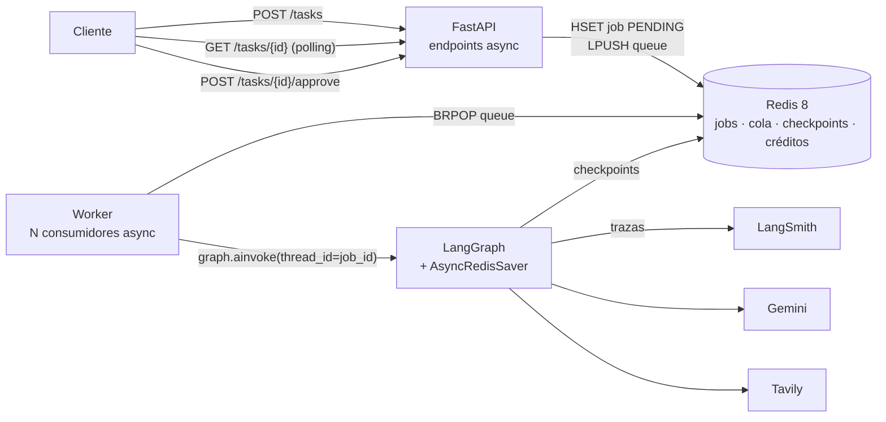
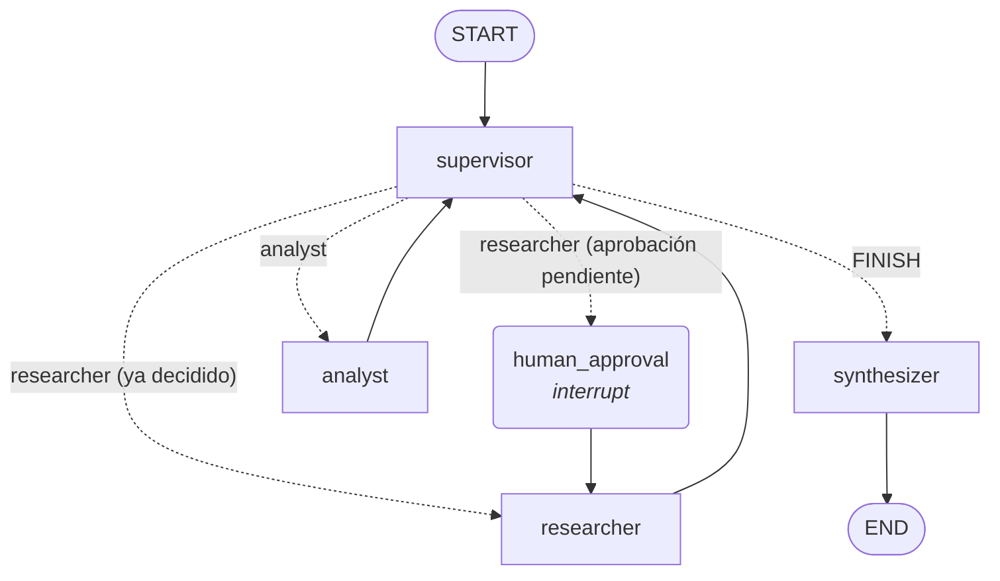

# AgentOps API: orquestador multi-agente en producción

API REST asíncrona (FastAPI) que expone el **orquestador multi-agente del Módulo 6**
Un Supervisor coordina a un Investigador (Tavily) y a un Analista (cálculo y sentimiento) sobre Gemini, con:

- **Endpoints que no bloquean:** `POST /tasks` encola y devuelve un `job_id` en milisegundos. El grafo corre en un worker.
- **Redis** como única fuente de estado: jobs, cola, checkpoints de LangGraph (`AsyncRedisSaver`) y guardián de créditos.
- **Observabilidad con LangSmith:** cada ejecución deja una traza con nodos, sub-agentes, tools, tokens y costo.
- **Human-in-the-loop:** el grafo se detiene con `interrupt()` antes de gastar créditos en búsquedas pagas y espera `POST /tasks/{id}/approve`.

## Arquitectura



### El grafo



### Ciclo de vida de un job

```
PENDING ──worker──> RUNNING ──┬──> DONE
                              ├──> FAILED              (excepción · timeout · worker caído)
                              └──> AWAITING_APPROVAL ──POST /approve──> PENDING ──> RUNNING ──> ...
```

Cada transición se registra en `GET /tasks/{id}?events=true`.

## Estructura

```
agentops-api/
├── app/
│   ├── main.py              # FastAPI: POST /tasks · GET /tasks/{id} · GET /tasks · /health · /graph
│   ├── graph.py             # grafo del M6 + nodo human_approval + AsyncRedisSaver (thread_id = job_id)
│   ├── worker.py            # consumidores de la cola, PENDING/RUNNING/AWAITING_APPROVAL/DONE/FAILED, reaper
│   ├── hitl.py              # nodo de aprobación (interrupt) + endpoint POST /tasks/{id}/approve
│   ├── observability.py     # LangSmith: init, run config (run_id, tags, metadata thread_id), flush
│   ├── jobs.py              # estado de jobs y cola en Redis, con transiciones atómicas (Lua)
│   ├── config.py · redis_client.py
│   └── orchestrator/        # código del M6 pasado a async
│       ├── state.py         #   estado compartido + campos de HITL
│       ├── llm.py           #   Gemini + fallback async decorado con @traceable
│       ├── agents/          #   supervisor (+ synthesizer), researcher, analyst
│       ├── tools/           #   web_search (Tavily + créditos en Redis), mock_search, cálculo, sentimiento
│       └── data/            #   corpus local para mock_search
├── scripts/
│   ├── load_test.py         # 5 peticiones concurrentes + aprobación HITL automática + p50/p95
│   └── langsmith_report.py  # costo/latencia/tokens por nodo leídos de la API de LangSmith
├── tests/test_flow.py       # integración sin LLM: FAILED, HITL aprobar/rechazar, 409 por doble aprobación
├── screenshots/             # capturas del dashboard de LangSmith
├── docker-compose.yml       # redis + api + worker
├── Dockerfile · requirements.txt · .env.example
```

## Cómo levantarlo

### Requisitos

- Python 3.12+ (probado con 3.13) y Docker.
- Keys de `GOOGLE_API_KEY` (Gemini), `TAVILY_API_KEY` (opcional) y `LANGSMITH_API_KEY` (<https://smith.langchain.com> → Settings → API Keys).

```bash
cp .env.example .env     # completar las keys
```

### Opción A: Docker Compose (Redis + API + worker separado)

```bash
docker compose up --build
# más workers consumiendo la misma cola:
docker compose up --build --scale worker=2
```

### Opción B: local (Redis en Docker, API con worker embebido)

```bash
# 1) Redis 8 (ya trae RedisJSON y RediSearch, que necesita RedisSaver)
docker run -d --name agentops-redis -p 6379:6379 redis:8.2-alpine

# 2) Entorno y API
python -m venv .venv
.venv\Scripts\activate                 # Linux/Mac: source .venv/bin/activate
pip install -r requirements.txt
uvicorn app.main:app --port 8000       # RUN_EMBEDDED_WORKER=true: el worker corre dentro de la API

# (alternativa) worker como proceso aparte:
#   RUN_EMBEDDED_WORKER=false uvicorn app.main:app --port 8000
#   python -m app.worker
```

Swagger en <http://localhost:8000/docs>. Chequeo rápido: `GET /health`.

> **Redis:** `langgraph-checkpoint-redis` necesita los módulos **RedisJSON** y **RediSearch**. Los traen Redis 8+ y Redis Stack. Con un Redis 7 "pelado", `asetup()` falla.

## Uso de la API

```bash
# 1) Encolar: responde 202 enseguida
curl -X POST localhost:8000/tasks -H "Content-Type: application/json" \
  -d '{"query": "Tasa de politica monetaria actual del Banco Central de Chile y cuanto rinde 1.000.000 CLP en un año", "max_steps": 6}'
# {"job_id": "c6f5...", "status": "PENDING", "links": {...}}

# 2) Polling
curl localhost:8000/tasks/<job_id>
# status=AWAITING_APPROVAL -> trae approval_request:
# {"type": "paid_web_search", "estimated_credits": 4, "credits_remaining": 1496, ...}

# 3) Aprobación humana (o {"approved": false} para trabajar solo con el corpus local)
curl -X POST localhost:8000/tasks/<job_id>/approve -H "Content-Type: application/json" \
  -d '{"approved": true, "reviewer": "franco", "comment": "ok gastar créditos"}'

# 4) Polling hasta DONE: result, decisions, contributions, approval, trace.run_ids, duration_seconds
curl "localhost:8000/tasks/<job_id>?events=true"
```

## Human-in-the-loop

**Qué es crítico:** las búsquedas en Tavily cuestan créditos de una cuenta con presupuesto limitado (1500).
La primera vez que el supervisor deriva al researcher, la arista pasa por el nodo `human_approval`, que:

1. Estima el costo (`TAVILY_MAX_SEARCHES_PER_RUN` × 1 crédito) y lo compara con `HITL_AUTO_APPROVE_MAX_CREDITS` (default 0, o sea que siempre pide aprobación).
2. Si hace falta aprobación, llama a `interrupt(payload)`. El checkpoint queda en Redis y el worker marca el job `AWAITING_APPROVAL` con el `approval_request`. **El worker queda libre**: no hay ninguna corrutina esperando.
3. `POST /tasks/{id}/approve` hace la transición atómica `AWAITING_APPROVAL → PENDING` (una segunda aprobación devuelve 409) y reencola el job con `action=resume`.
4. El worker reanuda el **mismo thread** con `Command(resume=decision)`. Puede ser otro proceso, o la API después de un reinicio, porque el estado está en Redis.
5. **Si se aprueba**, el researcher usa Tavily. **Si se rechaza**, el researcher se construye **sin** `web_search`. Lo impone el código, no el prompt.

Sin `TAVILY_API_KEY` no hay costo y el gate deja pasar sin preguntar (`search_approval=not_required`).

## Persistencia en Redis

| Clave | Tipo | Contenido |
|---|---|---|
| `agentops:job:<id>` | HASH | status, query, result, error, error_detail, approval_request, decisions, contributions, trace, timings |
| `agentops:job:<id>:events` | LIST | historial de transiciones |
| `agentops:jobs` | ZSET | índice por fecha (para `GET /tasks` y el reaper) |
| `agentops:queue` | LIST | cola de trabajo (`LPUSH` / `BRPOP`) |
| `agentops:tavily:*` | STRING | créditos usados (global), búsquedas por job y caché de resultados |
| `checkpoint:*` | JSON | checkpoints de LangGraph (`AsyncRedisSaver`, TTL 7 días) |

**Manejo de errores:** si el grafo falla en segundo plano, el worker captura la excepción y deja el job en `FAILED` con `error` y `error_detail` (tipo y traceback recortado). El cliente siempre llega a un estado terminal (`terminal: true`). También terminan en `FAILED`:

- un timeout por ejecución (`JOB_TIMEOUT_SECONDS`);
- un worker detenido a mitad de un job;
- un job que queda `RUNNING` sin actividad porque murió el proceso (lo detecta el **reaper**).

## Observabilidad (LangSmith)

- `LANGSMITH_TRACING=true` alcanza para que LangGraph y LangChain tracen todo: nodos, sub-agentes ReAct, tools y llamadas a Gemini con tokens de entrada y salida.
- `app/orchestrator/llm.py` decora la llamada al LLM con `@traceable` (span `llm_fallback`) y deja en metadata el `model_used` y los `attempts` del fallback entre modelos de Gemini.
- Cada ejecución es una traza raíz `agentops-job` con un `run_id` propio, que queda guardado en el job (`trace.run_ids`). Lleva tags `action:start` / `action:resume` y metadata `job_id` / `thread_id`. Con eso, la vista **Threads** agrupa la corrida inicial y la reanudación del mismo job.

**Costo por ejecución:** LangSmith lo calcula con los tokens de entrada y salida y su tabla de precios por modelo. Los modelos Gemini 3.x ya figuran en esa tabla. Si algún modelo apareciera con costo `$0`, se carga en **Settings → Model Pricing**.

## Prueba de carga: 5 peticiones concurrentes

```bash
python scripts/load_test.py            # 5 jobs en paralelo; aprueba el HITL automáticamente
python scripts/langsmith_report.py     # costo por job, p95 y tokens por nodo según LangSmith
```

`load_test.py` muestra el tiempo de encolado (debería estar en el orden de los ms, lo que prueba que la API no se bloquea), la latencia end-to-end y de procesamiento de cada job, y los p50/p95. Guarda los `run_ids` en `screenshots/load_test_results.json`.

**Cómo leer el dashboard.** En el proyecto `agentops-api` de LangSmith, filtrar por la tag `action:resume`. Esas trazas son el trabajo real; las `action:start` duran segundos porque terminan en el interrupt. En el *Monitor* del proyecto están la latencia p50/p99 y el costo. El p95 se arma con un chart custom de latencia, o con `langsmith_report.py`, que lee los mismos runs.

### Resultados de la corrida (2026-11-16, Docker Compose, 1 worker con 5 consumidores)

Salidas completas: [screenshots/load_test_results.json](screenshots/load_test_results.json) y [screenshots/langsmith_report.txt](screenshots/langsmith_report.txt).

| Métrica | Valor |
|---|---|
| Jobs | 5/5 DONE, 0 FAILED |
| Tiempo de encolado (`POST /tasks`) | 9–52 ms (p95 44 ms) |
| Paralelismo | 695 s de trabajo sumado en 199 s de reloj |
| **Costo por ejecución (LangSmith, vista Threads)** | **0,026 USD de media** (0,007–0,039) · 0,13 USD en total · [captura](screenshots/03-cost-per-run.png) |
| **Latencia p95 por traza (dashboard de LangSmith)** | **100,5 s** · [captura](screenshots/04-latency-p95.png) |
| Latencia por job (arranque + reanudación, `langsmith_report.py`) | p50 120,3 s · p95 181,9 s |

> El dashboard calcula el p95 sobre cada traza por separado (10 trazas: 5 `action:start` + 5 `action:resume`). El script suma las 2 trazas de cada job y da la latencia completa del job. Con tan pocas trazas, el percentil de LangSmith es aproximado (da lo mismo para p95 y p99).

**Lectura del dashboard**

- **Dónde se concentra la latencia:** en `supervisor` (media 22 s, máximo 87 s) y `researcher` (media 18,6 s, máximo 89 s). No es tiempo de cómputo. Con 5 jobs concurrentes, el free tier de Gemini devolvió 51 errores 429/503 y el fallback (`llm_fallback`) fue probando otros modelos con espera. En la traza se ve como spans `llm_fallback` con varios intentos (`attempts`) antes del que responde. El job más lento (196 s) es el que más reintentos acumuló. El nodo `human_approval` no suma latencia de proceso: el interrupt libera al worker.
- **Qué nodo consume más tokens:** el `researcher`, con el 45 % del total (48 k de entrada). El loop ReAct reenvía en cada vuelta los resultados de Tavily (5 resultados de hasta 700 caracteres por búsqueda). Le siguen `analyst` (24 %), `supervisor` (22 %, una llamada por paso con todo el contexto) y `synthesizer` (8 %).
- **Mejoras que surgen de esta lectura:** recortar los extractos de Tavily o resumirlos antes de devolvérselos al agente (menos tokens en el researcher), y limitar las llamadas concurrentes a Gemini con un semáforo para no disparar 429 en ráfaga (menos latencia de cola).

## Tests

```bash
pytest -q   # necesita Redis en REDIS_URL; no usa LLM ni créditos
```

Usan Redis real, `AsyncRedisSaver` real e `interrupt`/`resume` reales, con los agentes reemplazados por stubs.
Cubren el paso a FAILED por excepción, aprobar y reanudar (mismo thread, 2 corridas), rechazar (solo `mock_search`), la doble aprobación (409) y el caso sin Tavily (no hay HITL).

## Errores comunes y cómo se evitan

| Error | Solución |
|---|---|
| Bloquear el event loop | Endpoints `async` con `redis.asyncio`. El grafo usa `ainvoke` de punta a punta: Gemini, Tavily y Redis son async, y el fallback usa `asyncio.sleep`. Las tools síncronas (calculadora) LangChain las corre en el threadpool. |
| Excepciones silenciosas en background | `try/except` en el worker → `FAILED` con detalle. Hay timeout por job y reaper para jobs huérfanos. |
| Carreras con 5 jobs concurrentes | Transiciones de estado con Lua (compare-and-set). El guardián de créditos de Tavily pasó de un archivo JSON a Redis (reserva atómica + límite por job). |
| Sub-agentes heredando el checkpointer | Los agentes ReAct internos se compilan con `checkpointer=False`: solo el grafo padre persiste en Redis. |

## Stack

FastAPI · LangGraph 1.2 · langgraph-checkpoint-redis · Redis 8 · LangSmith · Gemini (langchain-google-genai) · Tavily · httpx · pytest
